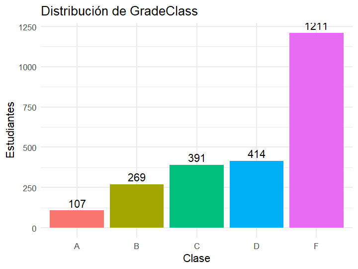
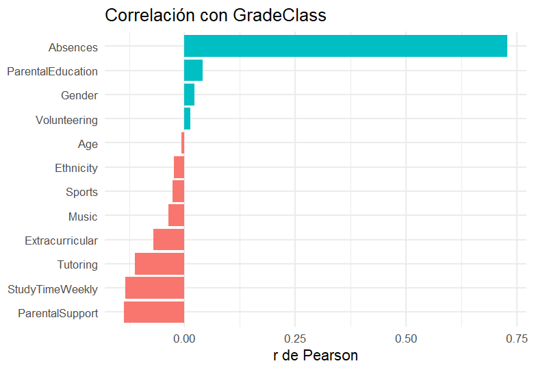
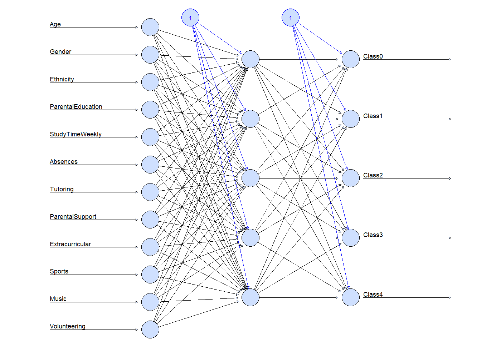
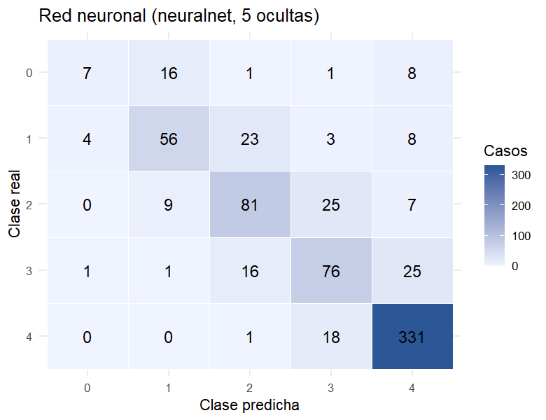
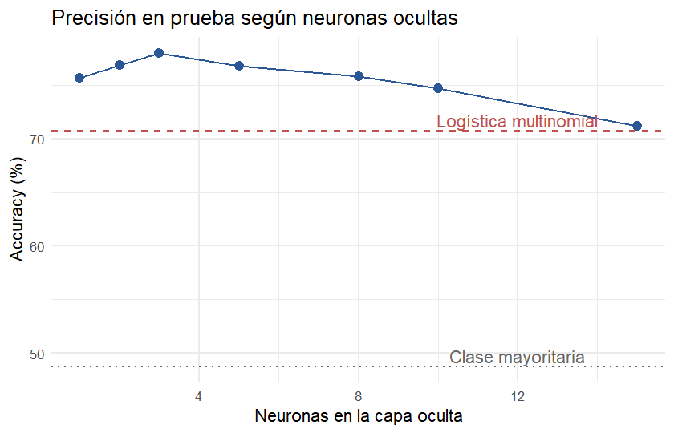

# Predicción del rendimiento académico con redes neuronales

Proyecto final de **Técnicas de Inteligencia Artificial**. Una red neuronal multicapa (paquete
`neuralnet` de R) clasifica a cada estudiante en su categoría de calificación (`GradeClass`: A, B,
C, D o F) a partir de sus hábitos de estudio, su entorno familiar y sus actividades extracurriculares.

## Datos

`data/Student_performance_data.csv`: 2 392 estudiantes, 15 columnas, sin valores faltantes.

| Atributo | Descripción |
|---|---|
| `Age` | Edad (15–18) |
| `Gender` | 0 = masculino, 1 = femenino |
| `Ethnicity` | 0–3 |
| `ParentalEducation` | Nivel educativo de los padres (0 = ninguno … 4 = posgrado) |
| `StudyTimeWeekly` | Horas de estudio por semana (0–20) |
| `Absences` | Ausencias en el año escolar (0–29) |
| `Tutoring` | Recibe tutoría (0/1) |
| `ParentalSupport` | Apoyo de los padres (0 = ninguno … 4 = muy alto) |
| `Extracurricular`, `Sports`, `Music`, `Volunteering` | Participa en la actividad (0/1) |
| `GradeClass` | **Objetivo**: 0 = A, 1 = B, 2 = C, 3 = D, 4 = F |

Se descartan dos columnas:

- `StudentID`: es solo un identificador.
- `GPA`: `GradeClass` se calcula directamente a partir del GPA, así que conservarlo le daría la
  respuesta a la red (fuga de información).

Las clases están desbalanceadas: la mitad de los estudiantes son F y solo el 4,5 % son A.



`Absences` es, con mucha diferencia, el atributo más relacionado con la calificación (r = 0,73).
Le siguen el apoyo de los padres, las horas de estudio y la tutoría, con correlaciones negativas
débiles: más de cada uno se asocia con una mejor calificación.



## Metodología

1. **Preprocesamiento**: los datos se dividen en 70 % de entrenamiento (1 674) y 30 % de prueba
   (718) con `set.seed(123)`. Las 12 entradas se escalan con min-max a [0, 1], usando solo los
   mínimos y máximos del conjunto de entrenamiento.
2. **Codificación del objetivo**: `GradeClass` se convierte a one-hot (`Class0` … `Class4`).
3. **Red neuronal** (`neuralnet`):
   - Arquitectura 12 → 5 → 5: una capa oculta de 5 neuronas y una salida por clase.
   - Activación logística (sigmoide) y salida no lineal (`linear.output = FALSE`).
   - Función de error: entropía cruzada (`err.fct = "ce"`).
   - Entrenamiento con retropropagación resiliente (`rprop+`, el valor por defecto) hasta que el
     gradiente baja de 0,01, con un máximo de 10⁶ pasos.
4. **Predicción**: la clase asignada es la salida con mayor activación (`max.col`).



## Resultados

| Métrica | Valor |
|---|---|
| **Accuracy en prueba** | **76,74 %** |
| Línea base (predecir siempre F) | 48,75 % |
| Pasos de entrenamiento | 470 442 (≈ 16 min) |

| Clase | Casos | Precisión | Recall | F1 |
|---|---|---|---|---|
| A | 33 | 0,583 | 0,212 | 0,311 |
| B | 94 | 0,683 | 0,596 | 0,636 |
| C | 122 | 0,664 | 0,664 | 0,664 |
| D | 119 | 0,618 | 0,639 | 0,628 |
| F | 350 | 0,873 | 0,946 | 0,908 |



- La red supera a la línea base por 28 puntos.
- Casi todos los errores ocurren entre **clases vecinas** (B↔C, C↔D, D↔F). Esto es esperable,
  porque las categorías vienen de cortar una escala continua (el GPA).
- La clase **A** es la más difícil (recall 21 %): solo tiene 33 ejemplos en prueba y la red tiende
  a confundirla con B.

### Comparación con otros modelos

`R/02_comparacion.R` entrena, con la misma división y el mismo escalado, una regresión logística
multinomial (una red sin capa oculta) y redes de distinto tamaño con `nnet`. `nnet` usa BFGS y
tarda segundos en lugar de minutos.

| Modelo | Neuronas ocultas | Accuracy |
|---|---|---|
| Logística multinomial | 0 | 70,75 % |
| Red neuronal (`nnet`) | 1 | 75,63 % |
| Red neuronal (`nnet`) | 3 | **77,99 %** |
| Red neuronal (`nnet`) | 5 | 76,74 % |
| Red neuronal (`nnet`) | 10 | 74,65 % |
| Red neuronal (`nnet`) | 15 | 71,17 % |



- La capa oculta aporta unos 6–7 puntos frente al modelo lineal, así que la relación entre los
  atributos y la calificación no es lineal.
- Con más de 3–5 neuronas la precisión en prueba empieza a bajar: la red se **sobreajusta** a los
  datos de entrenamiento.
- La arquitectura elegida, de 5 neuronas, está cerca del óptimo.

## Conclusiones

- Las **ausencias** son el factor dominante en el rendimiento. El apoyo de los padres, las horas
  de estudio y la tutoría tienen un efecto menor pero consistente.
- Una red pequeña (5 neuronas ocultas) clasifica correctamente a 3 de cada 4 estudiantes y casi
  nunca falla por más de una categoría.
- **Mejoras posibles**:
  - balancear las clases (sobremuestreo o pesos) para mejorar la detección de la clase A;
  - validación cruzada en lugar de una sola división;
  - plantear el problema como regresión sobre el GPA y discretizar después.

## Estructura del repositorio

```
├── PROYECTO.R                 # Modelo principal: red neuronal con neuralnet
├── R/
│   ├── utils.R                # Carga, división, escalado, métricas y gráficas
│   ├── 01_exploracion.R       # Análisis exploratorio
│   ├── 02_comparacion.R       # Logística multinomial vs. redes nnet de distinto tamaño
│   └── PROYECTO_original.R    # Versión original del script
├── data/Student_performance_data.csv
└── resultados/                # Gráficas, métricas y modelo entrenado (modelo_nn.rds)
```

## Cómo ejecutarlo

Requiere R ≥ 4.2 y estos paquetes:

```r
install.packages(c("neuralnet", "nnet", "ggplot2"))
```

Desde la raíz del repositorio:

```bash
Rscript R/01_exploracion.R
Rscript R/02_comparacion.R
Rscript PROYECTO.R
```

`PROYECTO.R` carga el modelo ya entrenado (`resultados/modelo_nn.rds`) si existe. Para volver a
entrenarlo (≈ 16 min), cambia `REENTRENAR <- TRUE` al inicio del script.

Para usar los scripts desde RStudio, primero fija como directorio de trabajo la carpeta del
repositorio (*Session → Set Working Directory*).
